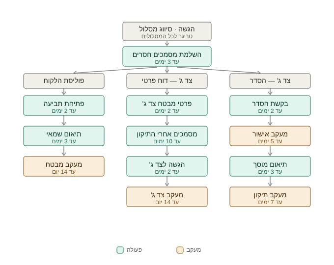
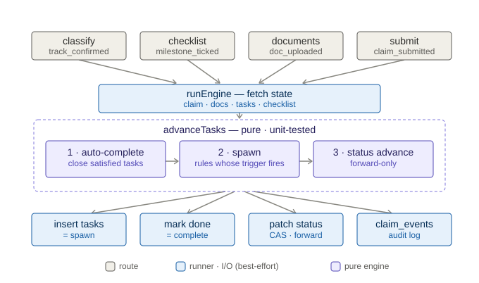

# Claim Management — ניהול התביעה לפי סוג

> מבוסס על מחקר דומיין + ניתוח טפסים אמיתיים. אחרי שהמסמכים נאספו, המערכת מסווגת את התביעה, ממלאת את טופס "הודעה על תאונה", ומציגה checklist לפי מסלול. ניהול משימות *אקטיבי* (תזכורות, רדיפה אחרי גורמים) = שלב 2.

---

## 1. סיווג סוג התביעה — מודל דו-שכבתי
ארבעת המסלולים אינם ערכים שווי-מעמד — הסיווג הוא **שתי החלטות בלתי-תלויות**. ראה מימוש: `web/src/lib/claims/classify.ts`.

| מסלול (`claim_type`) | מורכבות | תיאור |
|---|---|---|
| `own_policy` — פוליסת לקוח | פשוט | הלקוח מפעיל את הביטוח שלו |
| `third_party_report` — צד ג' (דוח פרטי) | **מורכב** | תובע את מבטח הפוגע; דורש "דוח פרטי" מלא שנאסף *אחרי* התיקון |
| `third_party_settlement` — צד ג' (הסדר) | פשוט יחסית | פנייה מראש למבטח הפוגע לאישור הסדר, ואז תיקון |
| `unknown` — לא ידוע עדיין | — | מצב התחלתי כשהאשמה/המסלול לא ברורים; ניתן לשנות בהמשך |

### שכבה 1 — למי הכיסוי? (עובדתי, נקבע דטרמיניסטית)
`own_policy` מול "צד ג'". הציר: **מי אשם** × **האם צד ג' מזוהה** × **סוג הכיסוי** (מקיף/חובה/צד ג').

| מצב | תוצאה | ודאות |
|---|---|---|
| אין צד ג' מזוהה + מקיף | `own_policy` | גבוהה |
| אין צד ג' מזוהה + ללא מקיף | `own_policy` + **אזהרת מימוש** | נמוכה |
| גניבה / ונדליזם / רכב יחיד / בעל חיים + מקיף | `own_policy` | גבוהה |
| פגע-וברח (לא מזוהה) + מקיף | `own_policy` | בינונית |
| צד ג' מזוהה + הלקוח אשם + מקיף | `own_policy` (הצד השני עשוי לתבוע — טיפול נפרד) | גבוהה |
| צד ג' מזוהה + הלקוח אשם + ללא מקיף | `own_policy` + **אזהרת מימוש** | נמוכה |
| צד ג' מזוהה + הצד השני אשם | **מעבר לשכבה 2** | גבוהה |
| אשמה לא ברורה + מקיף | `own_policy` (להתקדם; המבטח ישבב בהמשך) | בינונית |
| אשמה לא ברורה + ללא מקיף | `unknown` | נמוכה |

### שכבה 2 — איזו אסטרטגיית צד ג'? (החלטה עסקית, לא עובדתית)
`third_party_report` ("דוח פרטי") מול `third_party_settlement` ("הסדר"). **שתיהן דורשות אותן עובדות** (צד ג' אחראי + מזוהה) — ההבדל הוא בחירת טיפול, ולכן ה-AI **אינו** מכריע: הוא מסמן `needsAgentChoice` וממליץ על `report` כברירת מחדל (תיק מלא, ללא תלות בשיתוף פעולה מוקדם של מבטח צד ג'), **והסוכן בוחר**. הבחירה מזינה checklist שונה לגמרי (§3).

### המנוע (hybrid) — כללים + LLM
- **כללים דטרמיניסטיים** מחזיקים את החלטת המסלול — auditable, ללא הזיות.
- **ה-LLM מספק סיגנלים בלבד** מהתיאור המילולי: `incident_kind` (התנגשות/גניבה/פגע-וברח/…) ו-`inferred_fault` (מי אשם *לפי התיאור*, לא לפי מה שהלקוח סימן). **ה-LLM אינו בוחר מסלול.**
- **ודאות** (`high|medium|low`): נמוכה, או `needsAgentChoice` → ה-UI מחייב בחירה מפורשת של הסוכן.
- **אי-התאמת אשמה** (`fault_assessment.mismatch`): הלקוח סימן X אך התיאור נקרא כ-Y → אזהרה לסוכן.
- **אזהרת מימוש** (`viability_warning`): אשם + ללא מקיף = ייתכן שאין תביעה רכושית ברת-מימוש. **צד ג' מזוהה אך דיווח כ"לא מבוטח"** (`thirdPartyUninsured`, expert review 2026-11-01) אינה הופכת את המסלול — עדיין `third_party_report`, הבחירה נשארת של הסוכן — אבל מורידה את הוודאות ל-**נמוכה** ומוסיפה אזהרה מקבילה: אין מבטח צד ג' לתבוע מולו, לבדוק גבייה מול הנהג/בעל הרכב; קיים מקיף מרכך את הניסוח בלבד. ה"לא מבוטח" הזה הוא תשובה ודאית (אין ביטוח) ושונה מ**"לא ידוע"** (טרם נבדק) — רק "לא מבוטח" על **כל** כלי הרכב המדווחים מפעיל את האזהרה; כלי רכב אחד מבוטח מספיק כדי לא.

**קלט לסיווג:** סוג הכיסוי (מקיף/חובה/צד ג' — נאסף מהלקוח בשלב האיסוף; הלקוח יכול גם לענות **"לא בטוח/ה — יושלם בהמשך"**, ואז הכיסוי מגיע לסיווג כלא-ידוע ו**אזהרת מימוש אינה מוצגת** — לא נדע אם אין מקיף), שדה **"מי אשם"**, האם צד ג' מזוהה, האם הצד השני דווח כלא-מבוטח, וסיגנלים מהתיאור המילולי.
**החלטה שננעלה:** ה-AI **מציע** + **הסוכן מאשר**. ברירת מחדל `unknown`; ניתן לשינוי. ניתוח ה-AI נשמר במטמון ב-`claims.summary_json.analysis` (מחושב פעם אחת בצפייה הראשונה של הסוכן, עם input-hash לביטול מטמון בעריכה).

> הערה: קיים גם מסלול **שיבוב** (המבטח של הלקוח משלם ואז חוזר אל צד ג') — נתעד כ-future.

> **Fork בתוך `third_party_report`:** אם הלקוח **כבר הפעיל את הפוליסה שלו**, נותרת לו **תביעת הפסדים** מול מבטח צד ג' (השתתפות עצמית, אובדן הנחת היעדר תביעות, רכיבים שלא שופו). זהו Route נפרד תפעולית: נדרש **אישור הפסדים** — לא אישור אי-הגשה. מיוצג ע"י הדגל `policy_activated` (לא כ-`claim_type` נפרד). טרם אומת עם סוכנים (הנחה R1 ב-`assumptions-canvas.md`).

> **Fork נוסף: ללא תיקון — תביעה לפי אומדן ("דו"ח גלובלי").** צד ג' אשם (לרוב מודה), הנזק קטן, והלקוח בוחר **לא לתקן** ולקבל את סכום האומדן. הלקוח מזמין שמאי פרטי שבודק ומצלם את הרכב אצלו (לא במוסך) ומוציא דוח; הסוכן מרכיב תיק ומגיש למבטח צד ג'. מיוצג ע"י הדגל `no_repair` (migration 017, לא `claim_type` נפרד) — מתג "ללא תיקון (תביעה לפי אומדן)" בקוקפיט, `PATCH /api/claims/[id]/flags`. כשהוא דולק יורדים מהרשימה **חשבונית תיקון מקורית**, **קבלה על תשלום** ואבן הדרך **רכב נכנס למוסך**; כל השאר נשאר (דוח שמאי, חשבון + קבלה על שכ"ט שמאי, מכתב דרישה, טופס הודעה, רישיון רכב, תמונות, פרטי בנק, אישור אי-הגשה / הפסדים). ההחלטה לרוב מתקבלת בהתחלה אבל **יכולה להשתנות באמצע** — הרשימה מחושבת מחדש, מסמכים שהועלו לא נמחקים. מקור: מקרה אמיתי של המפתח (2026-11). **הנחה פתוחה:** תשלום לפי אומדן ללא תיקון משולם בד"כ **ללא מע"מ** (אין חשבונית) — לאמת מול סוכן לפני שמציגים זאת ב-UI. כרגע רק ב-`third_party_report`; תביעת אומדן מול פוליסת הלקוח (`own_policy`) לא נתמכת.

---

## 2. מסמכים שנוצרים (Generated outputs)
המערכת מייצרת תוצרי PDF מנתוני התיק. כל תוצר שמור ב-`generated_forms`.

| סוג (`kind`) | תיאור | מסלולים |
|---|---|---|
| `accident_notice` | טופס "הודעה על תאונה" — per-insurer | כולם |
| `demand_form` | טופס דרישה לצד ג' (נבנה — ראו למטה) | `third_party_report` |
| `submission_packet` | תיק הגשה מלא (bundle) | `third_party_report` |

### טופס "הודעה על תאונה"
המערכת ממלאת את הטופס אוטומטית מהנתונים → PDF מוכן. נבדק: per-insurer, ~80% משותף, PDF שטוח → overlay. גישה: סכמה קנונית + תבנית למבטח. מיפוי מלא: [form-field-map.md](form-field-map.md).
‏הלקוח בוחר את **חברת הביטוח שלו** בטופס האיסוף — זה קובע איזו תבנית מתמלאת. הטופס נוצר **אוטומטית בעת השליחה** ונשמר בתיק (`generated_forms`), והסוכן צופה/מוריד אותו מה-Dashboard. מבטחים עם תבנית כיום: **כל 11** — מגדל, מנורה, הכשרה, הראל, כלל, הפניקס, איילון, שלמה, ליברה, AIG, שומרה — וכולם ניתנים לבחירה בטופס האיסוף, כך שהמילוי האוטומטי בעת השליחה חל על כל לקוח.
‏הסוכן יכול **לערוך/להשלים את שדות הטופס הקנוניים** מה-Dashboard (`FormFieldEditor` → `PATCH /api/claims/[id]/form-data`) לפני יצירה מחדש; העריכות נשמרות ב-`summary_json.form_data`, הגשת הלקוח המקורית (`collected`) לא משתנה (audit), והמילוי מעדיף את `form_data` כשקיים.

### טופס דרישה (`demand_form`)
נבנה כ-`generated_forms.kind = 'demand_form'` (ללא מיגרציה); כל הקוראים מבחינים בינו לבין `accident_notice` דרך `web/src/lib/forms/kinds.ts`. נוצר **אוטומטית** כשהסוכן מאשר את המסלול `third_party_report` (ב-`after()`), ו**לפי דרישה** ב-`POST /api/claims/[id]/demand-form` (אופציונלי `{ at_fault_insurer }`). הנמען = מבטח הצד האשם (`resolveAddressee`); **השולח = פרטי העסק המטפל** (`agents.name/phone/email`, נערכים ב-`/dashboard/settings`).
פריט ה-checklist `demand_form` מתקיים ע"י טופס **שהועלה או שנוצר** — אך ב-`third_party_report` טופס **שנוצר** נספר רק כשיש סכום תיקון (`isRepairPriced`, `formFacts` ב-`kinds.ts`); טופס שהועלה לא מושפע; בהגשה מצורף הטופס שהועלה אם קיים, אחרת האחרון שנוצר ("טופס דרישה"). שדות עריכה חדשים ב-`FormFieldEditor`: מס' פוליסה, סוג ביטוח, מעורבות משטרה, שמאי, מס' תביעה אצל המבטח, קוד דגם, ת"ז צד ג'.
‏**פירוט הנזק (נוסף 2026-11-16, ללא מיגרציה):** שורות הנזק נשמרות **לפני מע"מ** ב-`summary_json.form_data.damages` (סכומים ב-₪, עד 2 ספרות אחרי הנקודה, לפני מע"מ; החישוב הפנימי באגורות שלמות; מע"מ 18%). נערכות ב-`DamagesFields.tsx` בתוך `FormFieldEditor` (רק `third_party_report`, עם תצוגה מקדימה חיה); `PATCH /api/claims/[id]/form-data` מאמת (`validateDamages`) ויוצר מחדש את טופס הדרישה בתוך הבקשה (לפני החזרת התשובה). מתג **עוסק מורשה** (`claimant_vat_registered`) מדפיס סכומים לפני מע"מ. המכתב מציג סעיף "פירוט הנזק": שורות כסף, שורת מע"מ וסה"כ בגופן גדול מעט יותר עם קו מעליו (לגופן משקל יחיד); שורות כסף לא נחתכות לעולם, ומכתב צפוף עובר לעמוד שני. רק הטופס האחרון נשמר (`cleanup.ts`). חישובים: `lib/demand/damages.ts`.
‏**הצעת סכומים מדוח השמאי (נוסף 2026-11-23, ללא מיגרציה):** כשמסמך מסוג `appraiser_report` עולה (או מתוקן ל-type הזה ב-re-file) על תביעת `third_party_report`, קריאת Claude נוספת (`extractAppraiserAmounts`, `web/src/lib/ai/extract-appraiser-amounts.ts`, חולקת את ה-helper המשותף `askAboutFile`/`file-call.ts` עם `classify-document.ts`) קוראת מהדוח את עלות התיקון (לפני מע"מ) ואת ירידת הערך, ושומרת אותן כ-`claim_events` מסוג `appraiser_amounts_extracted` — **בלי לגעת בטופס הדרישה**. הכרטיס `AppraiserSuggestion.tsx` (בלשונית סקירה, ליד ה-checklist) מציג לפקידה את הסכומים שנקראו מול מה שכתוב כרגע במכתב, עם אזהרה כשה-AI לא הצליח לאמת את הסכום מול הסה"כ בדוח (`verified: false`); "להכניס למכתב" כותב את השורות דרך אותו `PATCH /api/claims/[id]/form-data` שעורך הטופס משתמש בו (ומחולל את המכתב מחדש), "לא עכשיו" רק סוגר את ההצעה — שתי הפעולות נרשמות כ-`appraiser_amounts_resolved` (`POST /api/claims/[id]/appraiser-amounts`) למדידת דיוק החילוץ. ההצעה נעלמת מעצמה ברגע שהשורות בטופס תואמות למה שנקרא. לוגיקה טהורה: `lib/demand/appraiser-suggestion.ts` (`pendingSuggestion`/`applySuggestion`), חיבור להעלאה: `lib/demand/suggest-on-file.ts`.

---

## 3. Checklist לפי מסלול (מיושם — `web/src/lib/claims/checklist.ts`)
לכל מסלול: רשימת מסמכים/שלבים נדרשים + סימון מה קיים/חסר + הצעד הבא. **תצוגה נגזרת — בלי אוטומציה/רדיפה (שלב 2).** `computeChecklist()` היא פונקציה טהורה שרצה בצד השרת בדף התיק. הפריטים מקובצים לסקשנים: **מסמכי בסיס** · **מסמכים לאחר תיקון/הגשה** · **מסמכים מותנים** · **אבני דרך**.

**מבנה פריט ב-checklist — שני צירים:**
- **`mandatory | conditional`**: פריט חובה לכולם, או תלוי נסיבה (גניבה / שיעבוד / שימוש עסקי / פוליסה הופעלה...).
- **‏`clientSuppliable`** (ברירת מחדל: כן): האם **הלקוח** יכול לספק את המסמך בעצמו. ‏`false` על מסמכים שצד הסוכן מפיק — **מכתב דרישה** (`demand_form`), וכן **כל מסמכי צד-התיקון** (`appraiser_report`, `garage_invoice`, `assessor_fee_invoice`, `assessor_fee_receipt`, `repair_receipt`, בכל מסלול שבו הם מופיעים) — הוחלט 2026-11-11 שהמטפל בתיק מקבל אותם מהמוסך/השמאי, לא מהלקוח. כדי שהודעת רדיפה בוואטסאפ לא תבקש מהלקוח דבר שרק צד הסוכן יכול להפיק. הפריט עדיין מוצג וחוסם כרגיל (`appraiser_report`/`garage_invoice` עדיין חוסמים ב-`third_party_report`) — רק **גוף ההודעה** מסונן (`chaseableLabels`, משותף לרצועת המוכנות בתיק ולתור היוצא), והסוכן מעלה את מסמכי התיקון מה-Dashboard.
- **`blocking | non-blocking`**: חוסם הגשה לאותו מסלול, או מאחר רק את התשלום. אישור אי-הגשת תביעה במסלול צד ג' = **blocking dependency** (אחד החסמים שעצירתם מעכבת את השעון הרגולטורי). ‏לעומתו **הקבלה על תשלום** (`repair_receipt`) בצד ג' היא חובה בתיק אך **אינה חוסמת**: היא מגיעה מטבעה אחרי החשבונית, ולכן מאחרת רק את התשלום — החשבונית המקורית (`garage_invoice`) עצמה כן חוסמת.

**הchecklist דינמי לפי נסיבות** — נגזר מ-`claim_type` ⊕ דגלי נסיבה (`coverage_type`, `garage_network_rider`, `lien`, `business_use`, `theft`, `policy_activated`). ראה "כללים מותנים" להלן.

**איך מתעדכן (החלטה: אופציה א'):**
- **פריטי מסמך → אוטומטי.** ✓ מסומן ברגע שהמסמך קיים בתיק, לפי `satisfiedDocTypes` (`web/src/lib/claims/checklist.ts`) — לא עוד "יש שורה אחת מהסוג", אלא מספר מינימלי לפי סוג (`DOC_MIN_COUNT`): רישיון הנהיגה דורש **שתי** תמונות שהושלמו (שני הצדדים, פידבק מהפיילוט 2026-09-29), כל שאר הסוגים דורשים אחת. כדי שתיקים קיימים מהפיילוט לא ייפתחו מחדש בבת אחת (ותציף את הסוכנת ברשימת רדיפה), הדרישה של שני צדדים חלה רק על תיקים שנפתחו מ-`BOTH_SIDES_LICENCE_FROM` (2026-09-30T00:00) ואילך — תיקים ישנים יותר עדיין מסתפקים בצד אחד. מסמכים מאוחרים (חשבונית, דו"ח שמאי...) — **הסוכן מעלה אותם מה-Dashboard ובוחר סוג** (`POST /api/claims/[id]/documents`), וה-checklist מתעדכן לבד; מכרטיס ה-checklist עצמו יש כעת גם כפתור **העלאה** על כל שורת מסמך חסר שהסוכן רשאי להעלות (`AGENT_DOC_TYPES`), באותו endpoint — נוחות תצוגה בלבד, לא מנגנון חדש. ‏**מאז 2026-11-22** יש גם אזור גרירה (`DocDropZone`) שמעלה כמה קבצים בבת אחת ומתייג כל אחד לפי הסוג ש-Claude זיהה בו (`type=auto`, `web/src/lib/ai/classify-document.ts`) — ללא בחירת סוג מראש; קובץ שלא זוהה בביטחון מתויק כ"אחר", והתיוג תמיד ניתן לתיקון באותו בורר re-file שלמטה. אין סימון ידני של מסמכים. העלאה בטעות ניתנת לתיקון מכרטיסיית **קבצים**: לכל קובץ יש בורר סוג (**re-file**, `PATCH .../documents/[docId]`) וכפתור **מחק** (`DELETE .../documents/[docId]`, עם אישור) — מוסתרים בתיק סגור; מחיקה מחזירה את פריט ה-checklist ל"חסר" מיידית, כי התצוגה נגזרת-מצב.
- **פריט יכול לחול רק מתאריך מסוים (`appliesFrom`).** מנגנון כללי על `ChecklistItemDef`, נפרד מ-`BOTH_SIDES_LICENCE_FROM` לעיל (זה מכפיל את מספר הצדדים הנדרש לפריט קיים; `appliesFrom` קובע אם הפריט בכלל מופיע): רישיון נהיגה נוסף למסלולי צד ג' (`third_party_report`/`third_party_settlement`) כפריט בסיס חובה-לא-חוסם (אותו מעמד כמו עבר ביטוחי), אך **רק בתיקים שנפתחו מ-`TP_LICENCE_FROM` (2026-11-15T00:00) ואילך** — כדי שתיקי צד-ג' פתוחים-כבר לא ייפתחו מחדש בבת אחת ברשימת הרדיפה. תיקים ישנים יותר, וקוד קורא שלא מוסר תאריך פתיחה, ממשיכים לקבל את ה-checklist הקודם ללא הפריט. `computeChecklist()` מקבל לשם כך את `claims.created_at` כפרמטר (אופציונלי).
- ‏**דחייה מוצהרת מתועדת.** רישיון נהיגה (שני הצדדים, של מי שנהג בפועל — לא בהכרח המבוטח) ורישיון רכב חובה באיסוף (פידבק מהפיילוט), אך בלי לחסום את האשף עצמו — ב-`DocumentsStep` יש תיבת "אשלח בהמשך" לכל אחד מהם, ונשארת מוצגת גם אחרי שצולם צד אחד מתוך שניים. תיק בו הרכב היה חנוי (אין נהג) לא נדרש ברישיון נהיגה כלל. כל עוד המסמך חסר וה-checklist מזהה שהלקוח סימן דחייה (`docsDeferred` ב-`summary_json.collected`), הפריט מקבל הערה **"הלקוח סימן שישלח בהמשך"** (`DEFERRED_NOTE`) במקום להיראות כפער לא מוסבר — עדיין `done: false` ועדיין חוסם כרגיל, רק ההערה משתנה.
- **פריטים מותנים** נשלטים ע"י **דגלי נסיבות** על התיק (`theft` · `lien` · `business_use` · `policy_activated` · `garage_network_rider`, migration 004) — למשל אישור משטרה/מפתחות בגניבה, אישור הסרת שיעבוד ברכב משועבד, אישור רו"ח בלקוח עסקי, ו"אישור הפסדים" מול "אישור אי-הגשת תביעה" לפי אם הופעלה פוליסת הלקוח. ‏**הדגל קובע חסימה, לא הצגה** (`requiresFlag` בהגדרת הפריט): כל עוד הדגל כבוי הפריט עדיין מוצג — הסוכן עשוי לדעת שהוא רלוונטי — אבל אינו `blocking`, כך שתאונת התנגשות רגילה ב-`own_policy` לא נחסמת על אישור משטרה או אישור הסרת שיעבוד שהנסיבות שלה לא דרשו. ההחלפות בפועל הן `policy_activated`: `loss_confirmation` מחליף את `no_claim_confirmation` ברשימה, ו-`no_repair` (migration 017): ב-`third_party_report` מסיר את פריטי התיקון (חשבונית, קבלה, רכב נכנס למוסך).
- **פריטי פעולה/אבן-דרך → טיק ידני** (`PATCH /api/claims/[id]/checklist`): למשל "רכב במוסך". נשמרים ב-`checklist_state` על התיק (בוליאני בלבד). מתי שהטיק קרה נשמר בנפרד — שורת `claim_events` מסוג `milestone_ticked` בכל שינוי אמיתי (לא לחיצה כפולה), כדי לאפשר מדידת זמן בין אבני-דרך (`web/src/lib/claims/milestone-dates.ts`); טיקים שנעשו לפני 2026-10-09 אין להם תאריך. **ארבע אבני-הדרך המערכתיות** — "הוגש למבטח" / "הוגש לצד ג'" / "נשלחה בקשת הסדר" / "התקבל תשלום" — **אינן עוד ניתנות לטיק ידני** (ה-PATCH מחזיר 403): הן מסומנות אוטומטית דרך מסך השליחה ודרך דיאלוג עדכון הסטטוס, ראו "ניהול התביעה מול המבטחת" להלן, כדי לא לעקוף את שערי הראיה.
- ⏭️ שלב 2: קישור-המשך ללקוח/מוסך להעלאה ישירה (אופציה ב'). ‏תזכורות ללקוח כבר מוצעות דרך **"יוצא היום"** (סעיף 5) — בלחיצת אישור של הסוכן; שליחה אוטומטית ללא אישור עדיין לא.

### כללים מותנים (Conditional rules)
- **`theft`** → נדרשים אישור משטרה + מפתחות (`keys`).
- **`lien`** → נדרש אישור הסרת שיעבוד (`lien_release`) לפני תשלום.
- **`business_use`** → נדרש אישור רו"ח על שיעור קיזוז מע"מ (`vat_offset_confirmation`).
- **`garage_network_rider`** ("נבחרת מוסכים") → **אזהרה:** תיקון מחוץ לרשת עלול לבטל תגמולים; checklist מסמן אזהרה ב-blocking.
- **תיקון מחוץ להסדר** (ללא מוסך-הסדר) → נדרש אומדן ראשוני *לפני* התיקון (חובת הקטנת הנזק); אחרת המבטח רשאי לערער על גובה החשבונית.
- **`policy_activated = true`** במסלול צד ג' → המסלול עובר ל-"תביעת הפסדים": נדרש **אישור הפסדים** (`loss_confirmation`) במקום אישור אי-הגשה (`no_claim_confirmation`).

### `own_policy` — פוליסת לקוח
**שלבים:** איסוף מסמכים → מילוי טופס הודעה → פתיחת תביעה מול מבטח הלקוח → שמאי / מוסך → אישור תיקון / תשלום → סגירה.
**מסמכים:** טופס הודעה על תאונה, רישיון נהיגה (לקוח + צד שני אם קיים), רישיון רכב, תמונות נזק.

### `third_party_report` — צד ג' (דוח פרטי) · המורכב
**שלבים:** איסוף פרטי צד ג' → רכב נכנס למוסך → שמאי בודק → תיקון → חשבונית תיקון → איסוף "דוח פרטי" → הגשה למבטח צד ג' → מעקב אישור / דחייה / השלמות → קבלת תשלום.
**מסמכים שמבקשים כבר בפתיחת התביעה:** טופס הודעה · טופס דרישה · אישור אי-הגשת תביעה (חוסם) · עבר ביטוחי (חובה, לא חוסם עד שהפיילוט יאשר שהמבטחות לא מטפלות בלעדיו) · רישיון נהיגה (חובה, לא חוסם — כנ"ל; רק בתיקים שנפתחו מ-2026-11-15 ואילך, ראו §3).
**מסמכים אחרי התיקון:** חשבונית תיקון · דו"ח שמאי · קבלה על תשלום · שכ"ט שמאי · פרטי חשבון בנק / אישור ניהול חשבון (אופציונלי).
**מי מספק (טרם אומת מול המוסך):** אישור אי-הגשה ועבר ביטוחי מגיעים כנראה מהמבטחת של הלקוח או מסוכן הביטוח שלו. בינתיים גם הלקוח (דרך הקישור) וגם הגורם המטפל יכולים להעלות אותם.
**הגשה:** כל מסמך מה-checklist שנמצא בתיק מצורף למייל למבטחת, גם אם הוא אופציונלי.

### `third_party_settlement` — צד ג' (הסדר) · הקל
**שלבים:** איסוף מסמכים ראשוני → פנייה למבטח צד ג' → בקשת אישור הסדר → אישור → תיקון במוסך → סיום.

### `unknown`
הצגת שאלת ההכרעה לסוכן (איזה מסלול) + המסמכים המשותפים שכבר נאספו, כדי לאפשר החלטה.

---

## 4. השעון הרגולטורי
השעון הרגולטורי של יישוב התביעה **מתחיל רק כשכל המסמכים הנדרשים בתיק** (`sla_clock_started_at`). ה-checklist מזין שדה זה: כל עוד יש פריט blocking חסר, השעון לא זז. לאחר שהוא מתחיל:
- **30 יום** → מועד ההכרעה (`decision_due_at`).
- **90 יום** → הודעת המשך בירור אם לא הסתיים.

ה-Dashboard אמור לשקף "השעון טרם החל — חסר: X" ו-"הכרעה נדרשת תוך N ימים".
פרטים, ציטוטים ומועדי התיישנות: [regulatory-clock.md](regulatory-clock.md).

## 5. מודל המשימות (מנוע משימות — מיושם)
טבלת `tasks` לכל תיק: `title`, `track`, `status`, `due_at`, `assignee`, ועמודות מנוע-המשימות `key`/`source`/`note`/`completed_at` (מיגרציה 006). **המנוע כבר מיושם** (`web/src/lib/tasks/`): פונקציה טהורה ואידמפוטנטית (`advanceTasks`) מריצה טבלת חוקים לכל `claim_type` — אירועים (הגשה / אישור track / סימון milestone / העלאת מסמך) יוצרים משימות, מסמנים משימות שהתנאי שלהן התקיים, ומקדמים את סטטוס התיק קדימה-בלבד. משימות ידניות של הסוכן (`source='manual'`, ללא `key`) לעולם לא נסגרות אוטומטית. **עודכן 2026-11-22:** המנוע גם סוגר משימת `template` פתוחה שאף חוק במסלול הנוכחי כבר לא מחזיק (מסלול שהוחלף אחרי פתיחת התיק, או חוק שבוטל) — אחרת הייתה נשארת פתוחה לנצח — וכש-התיק נסגר (`statusAdvance` ל-`closed`), כל משימות ה-`template` הנותרות נסגרות יחד איתו ושום משימה חדשה לא נפתחת. ‏**עודכן (PR #153):** מאותו היגיון, סוכן גם לא יכול לסגור משימת `template` ידנית — `PATCH .../tasks/[taskId]` עם `status:'done'` על משימה כזו נדחה (400), וב-TasksPanel יש לה רק "דחה ב-3 ימים"/"דחה בשבוע" (דוחה מהיעד הנוכחי או מההווה, הגבוה מביניהם) ו"חסום" במקום "✓ בוצע"; משימות ידניות שומרות על "בוצע" כרגיל. גם `open_claim_with_insurer` (מסלול `own_policy`) הפך ל-condition-triggered כמו `submit_to_tp_insurer`: נפתח כשנחסם האחרון מתבטל, לא בהכרח באישור ה-track. ה-checklist נותר תצוגה נגזרת שהמנוע קורא ממנה. ‏קיים **"תדריך בוקר"** (morning brief, `web/src/lib/brief/`) שמתעדף את כל התיקים הפתוחים: ציון היוריסטי דטרמיניסטי (משימות באיחור / מסמכים חוסמים / חוסר פעילות / דחוף) + סיווג רמת דחיפות (tier) ע"י Claude, עם נפילה-לאחור לחוקים-בלבד כש-AI לא זמין — מחליף את מנוע "מעקבים להיום" הקודם. ‏**כבוי כברירת מחדל מ-2026-09-27** (משוב סוכן פיילוט: היום שלה הוא איסוף ← טופס ← שליחה למבטח, לא תדריך ממוין) — מוצג ב-Dashboard רק מאחורי הדגל `BRIEF_ENABLED=1` (`web/src/lib/dashboard/flags.ts`); ברירת המחדל היא רשימה שטוחה, ממוינת לפי הפעילות האחרונה בתיק (יצירת קישור / הגשת הלקוח / העלאת מסמך — הכי מאוחר למעלה), עם תגית "חדש"/"מסמך חדש" לתיק שבו משהו קרה ביממה האחרונה.

‏מתחת לתדריך מוצג **"יוצא היום"** — תור היוצא (`web/src/lib/outbound/`, שלב 2 · צעד C1): התדריך מתעדף **תיקים**, התור מוציא **הודעות**, ולכן כפתור הרדיפה **הוסר מהתדריך**. שני נתיבים: **"לשלוח היום"** — הודעות ללקוח שמועדן הגיע (`finish_wizard` · `chase_missing_docs` · `get_tp_insurer` · `collect_private_report_docs`; ‏`collect_private_report_docs` נושא `requiresLabels` — מאז שמסמכי צד-התיקון agent-sourced (לעיל) אין לו עוד מה לבקש מהלקוח, ולרוב נופל במקום זה ל"לטפל היום" כמשימת סוכן; חריג: כשהופעלה פוליסת הלקוח, `loss_confirmation` עדיין נדרש מהלקוח ונשלח), בנוסח עברי דטרמיניסטי מ-`wa.ts` שנרנדר מחדש בכל קריאה (בלי LLM בלולאת השליחה) עם קישור `wa.me` בלחיצה אחת; ו**"לטפל היום"** — כל שאר משימות התבנית שמועדן הגיע, ועליהן שורות הסלמה. ‏**כלום לא נשלח בלי לחיצת הסוכן**, וכל שליחה וכל דילוג נרשמים ב-`outbound_events` (מיגרציה 008) — דילוג משתיק את החוק לתקופת הצינון בדיוק כמו שליחה. שלוש בקרות: צינון לכל חוק, **הודעה אחת לתיק ליום**, ואחרי 3 שליחות שאחריהן לא הגיע מסמך — השורה מפסיקה להיות מוצעת והופכת להסלמה **"הלקוח לא מגיב… ליצור קשר טלפוני"**. רק ההחלטות נשמרות; מה שניתן להציע נגזר בכל קריאה, ולכן התור לא יכול להתיישן. ראה [architecture.md](architecture.md).

> **סטטוס (2026-07-08):** מנוע המשימות (שלב 2 · צעד A) מומש — ראה הספק ב-[superpowers/specs/2026-07-08-task-engine-design.md](superpowers/specs/2026-07-08-task-engine-design.md) והמימוש ב-`web/src/lib/tasks/` (מנוע טהור `engine.ts` + חוקים דקלרטיביים `templates.ts` + runner ל-I/O). ‏**עודכן:** דירוג ה-AI (צעד B) מומש ב-2026-07-23, ותור היוצא (צעד C1) ב-2026-08-09 — ראה [superpowers/specs/2026-08-09-outbound-queue-design.md](superpowers/specs/2026-08-09-outbound-queue-design.md). שליחה אוטומטית ללא אישור סוכן (C2) עדיין לא מומשה.

### שרשראות המשימות לפי מסלול
כל אירוע (יצירת התיק / הגשה / סיווג / סימון אבן-דרך / העלאת מסמך) מוליד את המשימה הבאה בשרשרת, עם מועד יעד יחסי; השלמת משימה (אבן-הדרך או המסמך שהיא ממתינה לו) היא שמולידה את הבאה. טורקיז = פעולה/רדיפה, ענבר = מעקב. **מועדי היעד הם הנחות שדה** (`DUE_OFFSETS`), לא SLA רגולטורי — לכיול מול הסוכן.

### מכניקת המנוע — מאירוע בודד לפעולות
ה-runner (I/O, best-effort) מושך את מצב התיק, קורא ל-`advanceTasks` (פונקציה טהורה, מכוסה ב-unit tests) שמחזירה `{spawn, complete, statusAdvance}`, ואז מיישם את הכתיבות. כשל של המנוע לעולם אינו מפיל את ה-route שהפעיל אותו.

---

## 6. החלטות שננעלו (2026-06-17)
1. **4 מסלולים + `unknown`** (לפי מחקר הדומיין).
2. **סיווג:** מודל דו-שכבתי — כללים דטרמיניסטיים למסלול + LLM לסיגנלים מהתיאור; AI מציע + סוכן מאשר; ברירת מחדל `unknown`; ניתן לשינוי.
3. **checklist סטטי לפי מסלול נכנס ל-MVP**; workflow אקטיבי (תזכורות/רדיפה) = שלב 2.
4. **טופס:** per-insurer, סכמה קנונית + overlay.

---

## MVP מול עתידי
✅ **MVP:** איסוף → סיכום AI + חוסרים → סיווג (AI מציע, סוכן מאשר, 4 מסלולים) → טופס "הודעה על תאונה" → **checklist סטטי לפי מסלול** → תיק + Dashboard. הגדרה מלאה: [mvp-scope.md](mvp-scope.md).
⏭️ **שלב 2+:** רדיפה אחרי **הלקוח** כבר קיימת כתור אישור ("יוצא היום", סעיף 5); נותרו שליחה אוטומטית ללא אישור סוכן, רדיפה אחרי מוסך/שמאי/מבטח (אין להם שדות קשר בסכמה), WhatsApp API, מסלול שיבוב, OCR. מעקב תשלומים **בסיסי** נבנה (ראו סעיף "ניהול התביעה מול המבטחת" להלן) — חסרות עדיין חשבונית/התאמה (reconciliation) ברמת מוטב בודד.

---

## קישורים
- מחזור החיים ומכונת המצבים → [flow.md](flow.md)
- מודל נתונים → [architecture.md](architecture.md)
- היקף MVP → [mvp-scope.md](mvp-scope.md)
- מיפוי שדות הטופס → [form-field-map.md](form-field-map.md)
- אימות הנחות → [assumptions-canvas.md](assumptions-canvas.md)

## ניהול התביעה מול המבטחת (נוסף 2026-10-21)

אחרי שהתיק מוכן, הטיפול מול המבטחת מנוהל בשני שלבים:

**שליחה (הכנה ואישור):** המערכת מכינה את המייל במלואו — כתובת מחלקת התביעות הרלוונטית למסלול (מחלקת פוליסות במסלול "ביטוח עצמי", מחלקת צד ג' של המבטחת האחראית בשני מסלולי צד ג' — מתוך ספריית כתובות פר־מבטחת; כשאין כתובת למסלול אצל מבטחת מסוימת, מזינים ידנית), שורת נושא קבועה שמסתיימת במזהה קצר של התביעה (מפתח קישור לתשובות בעתיד), גוף הודעה בעברית ורשימת הקבצים לצירוף. ברירת המחדל: הפקידה שולחת מהתיבה שלה בהעתק־הדבק ומאשרת "סומן כנשלח". **כשהמייל של העסק מוגדר (migration `013`, כתובת מערכת + `claims_mailbox`):** אפשר גם לשלוח ישירות מהמסך — `POST /api/claims/[id]/submission/send` יוצא מכתובת המערכת של העסק, עם תיבת התביעות שלו בהעתק, ומסמן את אותה אבן־דרך מיד עם הצלחת השליחה. בשני המקרים האישור מסמן את אבן הדרך של המסלול (הוגש למבטח / הוגש לצד ג' / נשלחה בקשת הסדר) ומעביר את התביעה לסטטוס "נשלחה"; במסלולי צד ג' האישור גם קובע את המבטחת הקנונית של הצד השלישי (`at_fault_insurer`). ‏**במסלול `third_party_report`, בחירת המבטחת מהרשימה בלשונית השליחה נשמרת מיד כ-`at_fault_insurer`** (לא רק באישור הסופי) — כך גם נסגרת משימת `get_tp_insurer`; ה"פעולה הבאה" בכותרת התיק מפנה אז ללשונית "שליחה למבטחת" במקום לסקירה, כי שם המבטחת נבחרת. ‏**אם נותר בתיק מסמך חוסם חסר, לשונית השליחה מתריעה על כך אך אינה חוסמת** — הפקידה יכולה לאשר "לשלוח בכל זאת" במודע. שליחה ישירה נרשמת בטבלת `claim_emails` ומוצגת בתיק תחת "התכתבות", יחד עם כל תשובה שמתקבלת מהמבטחת; **תגובה אוטומטית של המבטחת** ("קיבלנו את פנייתך") משויכת לתיק לפי תזמון בלבד — התיק היחיד שנשלח אליו מייל לאותה כתובת בחמש הדקות האחרונות (`match_method='auto_ack'`, migration `016`) — ומייל נכנס שלא שויך כך או לפי מזהה/שרשור (למשל תשובה שלא נשאה את מזהה התביעה) ממתין ב"דואר נכנס" (`/dashboard/inbox`) לשיוך ידני. מייל שהתקבל נשלח גם כהעתק לתיבת התביעות של העסק (אלא אם העסק כבר נמען ישיר שלו); אם המבטחה מחזירה שגיאת מסירה על מייל ששלחנו, השורה המתאימה מסומנת `delivery_failed` ונפתחת משימה ("המייל למבטחת חזר — לבדוק כתובת ולשלוח שוב") — הסטטוס "נשלחה" עצמו לא חוזר אחורה. תיבת התביעות עצמה נערכת ב"הגדרות" (`/dashboard/settings`), לצד כתובת המערכת לקריאה בלבד והוראות ניתוב מיילים ממבטחות שמגיעים ישירות לתיבה של העסק (M365).

**בירור (סטטוסים מגובי־ראיה):** נשלחה ↔ המבטחת ביקשה השלמות ← אושרה—ממתין לתשלום ← תשלום חלקי ← שולמה, עם ענפים: נדחתה ← ערעור ← טיפול משפטי. כל מעבר "כספי" דורש ראיה בתיק לפני שהסטטוס משתנה: שולמה/תשלום חלקי — הודעת תשלום; נדחתה — מכתב הדחייה; השלמות/ערעור — פירוט; טיפול משפטי — פרטי עו"ד. רק "שולמה" (מלא) מסמן "התקבל תשלום" וסוגר את התיק — תשלום חלקי משאיר את התיק פתוח וגלוי בדשבורד. סגירת תביעה נרשמת עם סיבת סגירה (וסוגרת גם את כל משימות ה-`template` הנותרות, ראו §5). ארבע אבני הדרך המערכתיות אינן ניתנות עוד לסימון ידני — רק דרך מסך השליחה או דיאלוג עדכון הסטטוס.

**עדכון סטטוס ישירות מהמייל הנכנס (נוסף 2026-11-22):** כל עוד התביעה נשלחה ואינה סגורה, מייל נכנס שהפקידה עוד לא הכריעה לגביו נושא תחתיו שורת פעולה ב"התכתבות": כפתור לכל סטטוס חוקי מהסטטוס הנוכחי (חוץ מ"נשלחה") פותח את דיאלוג עדכון הסטטוס עם היעד כבר נבחר, קובץ המצורף למייל מוצע כברירת מחדל כראיה הנדרשת (אפשר גם "קובץ אחר") וגוף המייל ממלא מראש את "מה המבטחת ביקשה?"; או כפתור "אין שינוי בסטטוס" לסימון שהמייל לא מצריך פעולה. ההחלטה נשמרת על המייל עצמו (`handled_at`/`handled_as`, migration `015`) כך שהשורה נעלמת ומוצג רק מה הוכרע; "הגיע מייל מהמבטחת" הופך לפעולה הבאה בכותרת התיק (קודם לכל שורת בירור אחרת) וקופץ אל "התכתבות" בלחיצה. ‏**אם migration `015` לא הוחל עדיין** — ההתכתבות מוצגת כרגיל, אבל בלי שורות פעולה; המעברים הרגילים דרך דיאלוג הסטטוס ממשיכים לעבוד.

‏**ביטול שיוך מייל (נוסף 2026-11-24):** מייל נכנס שמשויך לתיק מקבל ב"התכתבות" כפתור "ביטול שיוך" (אישור לפני ביצוע) שמחזיר אותו לדואר הנכנס לשיוך מחדש — ‏`DELETE /api/emails/[id]/assign`, compare-and-set על התיק שאליו הוא משויך כרגע. מותר כל עוד המייל עדיין לא הוכרע או שסומן כ"אין שינוי בסטטוס"; חסום (`409`) ברגע שממנו בפועל נקבע סטטוס לתיק (`handled_as` הוא סטטוס ולא `none`), כי אותו מייל הוא התיעוד של למה הסטטוס השתנה.

**משימת המעקב עוקבת אחרי הסטטוס (נוסף 2026-11-22):** כל מעבר סטטוס (מלבד תשלום מלא, שסוגר את התיק) מחליף את משימת המעקב הפתוחה של התיק (`follow_up_insurer` ב-`own_policy`, `follow_up_tp_insurer` ב-`third_party_report`; למסלול הסדר אין משימת מעקב אחידה — נשאר לשרשרת הרגילה) באחת חדשה שכותרתה ומועד היעד שלה תואמים את הסטטוס החדש (`FOLLOW_UP_AFTER`, `web/src/lib/handling/followup.ts`) — למשל "לשלוח למבטחת את ההשלמות שביקשה" (3 ימים) אחרי "המבטחת ביקשה השלמות", "להחליט: ערעור או הליך משפטי" (7 ימים) אחרי "נדחתה". ב"פעולה הבאה" שבכותרת התיק, משימת מעקב שעדיין לא הגיע מועדה נחשבת המתנה לצד המבטחת ("אצל המבטחת…") רק בסטטוסים `sent`/`approved_awaiting_payment`/`appeal`; בכל סטטוס אחר (כגון "המבטחת ביקשה השלמות"/תשלום חלקי/נדחתה) זו משימת המטפל עצמו ומוצגת כפעולה הבאה גם לפני מועד היעד (`AWAITING_INSURER`, `web/src/lib/cockpit/derive.ts`).

**סכומים (נוסף 2026-11-15):** לתיק שני שדות כספיים אופציונליים — `demand_amount` (סכום הדרישה) ו-`paid_amount` (סכום ששולם), ש״ח, מוקלדים ידנית (migration `012`). נאספים בנקודות טבעיות — מסך השליחה מציע למלא את סכום הדרישה לפני "סומן כנשלח", ודיאלוג עדכון הסטטוס מציע את הסכום ששולם כש-היעד הוא "שולמה"/"תשלום חלקי" — אבל שניהם רשות ואפשר להשלים/לתקן בכל שלב מכרטיס "סכומים" בעמוד התיק. אלה מזינים את עמוד **`/dashboard/overview`** ("סקירה") — תמונת מצב כספית לבעל העסק: כסף שמחכה למבטחת לפי שלב ולפי ותק ההמתנה, חציוני זמן לכל שלב (איסוף ← הכנה ← שליחה ← תשלום), ושיעור השלמת איסוף מהלקוח.
